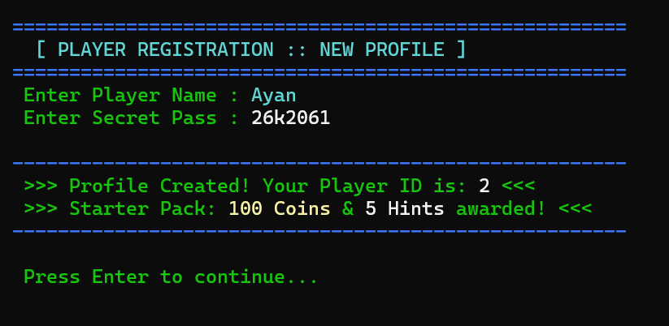
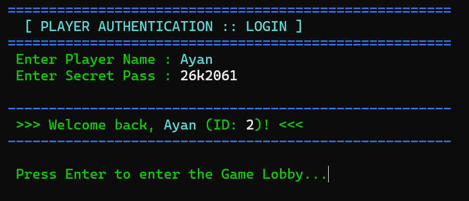
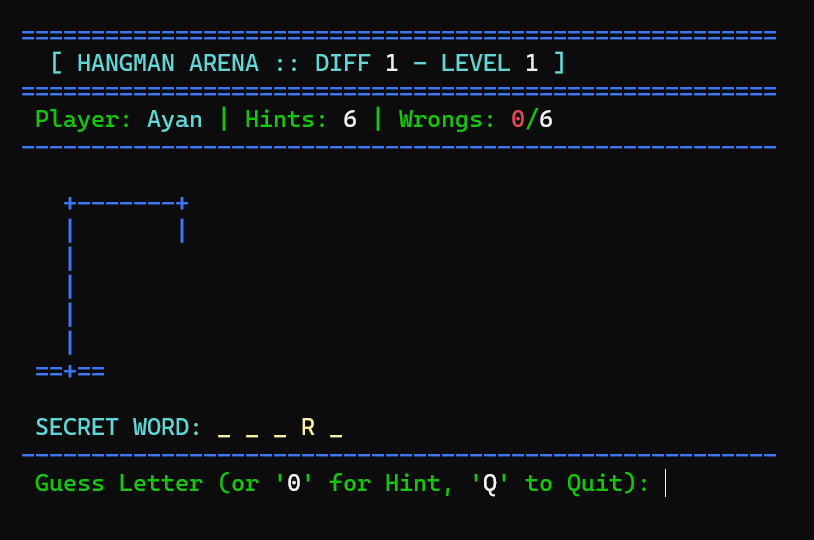
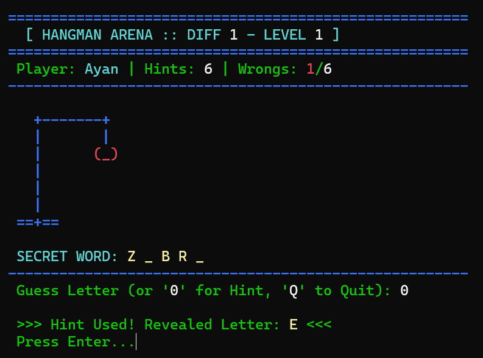
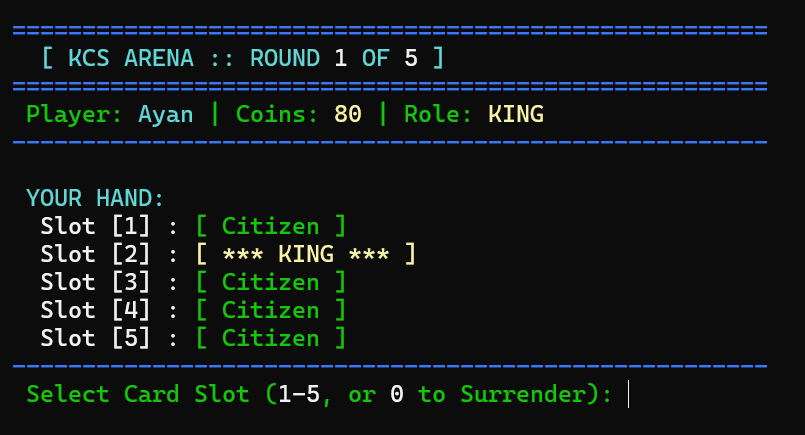
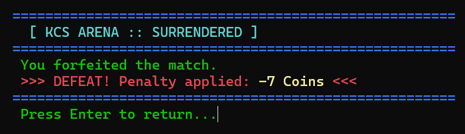

# BrainQuest: Quest & Gaming Portal

## Section A: Project Introduction
BrainQuest is a terminal-based arcade and puzzle portal written in C. Its core objective is to combine multiple interactive mini-games into a unified platform with permanent player profile persistence, a shared coin-and-hint economy, and a color-coded console interface. Players can register accounts, log in, earn virtual coins, purchase hints in an in-game marketplace, and play a 15-level Hangman word challenge alongside a strategic card game called King-Citizen-Slave (KCS).

## Section B: Features & Test Cases (Execution Scenarios)

### Case 1: Player Registration & Authentication
* **Description**: Tests new player account creation with default starter balances and login credential verification against `players.txt`.
* **Inputs**: Option `1` (Register) or `2` (Login), Player Name (`"Ayan"`), and Secret Password (`"pass123"`).
* **Expected Output**: Assigns a unique Player ID, awards a starter pack of 100 coins and 5 hints, saves the profile to disk, and enters the Main Game Lobby.
* **Screenshot**: 
* **Login View**: 

### Case 2: Hangman Word Challenge & Hint Economy
* **Description**: Tests multi-difficulty word decryption, wrong-guess tracking, first-clear vs. replay coin rewards, and the `0`-key hint system.
* **Inputs**: Selecting Difficulty `1`, entering letter guesses (`A-Z`), or pressing `0` to use a hint.
* **Expected Output**: Renders the ASCII gallows, updates the masked secret word, reveals a hidden letter when `0` is pressed, and awards +10 coins on first clear (+1 coin on replay).
* **Screenshot**: 
* **Hint Usage View**: 

### Case 3: KCS Card Arena & Edge-Case Handling
* **Description**: Tests the King-Citizen-Slave card clash hierarchy, slot reuse prevention, surrender penalties, and invalid input buffer handling.
* **Inputs**: Selecting card slots `1-5`, entering `0` to surrender, or entering invalid characters at menu prompts.
* **Expected Output**: Resolves round clashes (+8 coins on victory, -5 coins on defeat), applies a -7 coin surrender penalty (clamped at 0), and safely rejects invalid inputs without crashing.
* **Screenshot**: 
* **Surrender Edge Case**: 

## Instructions to Clone and Execute

### Step 1: Clone the Repository
Open your terminal and execute:
```bash
git clone https://github.com/muhammad-ayan-arshad/branquest_game.git
cd branquest_game
```

### Step 2: Compile the Code
Compile your C code using GCC or Dev-C++:
```bash
gcc main.c -o brainquest.exe
```

### Step 3: Run the Program
Windows (Command Prompt):
```cmd
brainquest.exe
```